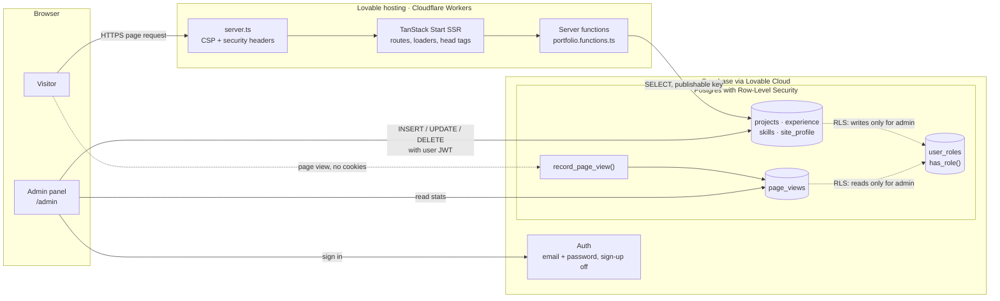

# Torsti Tapiola — Personal Website

Source code for my developer portfolio: a server-rendered React site where projects,
work experience, skills and profile details are stored in a Postgres database and
edited through a private admin panel, so updating the site never needs a code change.

**Live site: [torsti.dev](https://torsti.dev)**

## Features

- **Portfolio sections as separate routes:** home, experience, projects (with
  Markdown case studies), skills and contact, each with its own page title and
  meta tags for search engines and link previews.
- **Content from the database:** pages load their data on the server, so the
  first render already contains the content.
- **Admin panel at `/admin`:** create, edit, reorder and delete projects,
  experience entries, skills and profile information.
- **Database-enforced access control:** row-level security lets anyone read and
  only the admin role write. A UI check alone would not be enough, so the
  database enforces the rule.
- **Editorial, minimal design:** clean grid, monospace details, one accent
  colour, mobile-first layout.

## Tech stack

| Area | Tools |
| --- | --- |
| Framework | [TanStack Start](https://tanstack.com/start) (React 19, SSR, file-based routing, server functions) |
| Data fetching | TanStack Query (`queryOptions` + route loaders) |
| Database & auth | Supabase (Postgres, Row-Level Security, Auth) via Lovable Cloud |
| Migrations | Plain SQL files tracked with Drizzle Kit |
| UI | Tailwind CSS 4, shadcn/ui (Radix), Lucide icons, `react-markdown` |
| Tooling | Vite 8, TypeScript, ESLint, Prettier, Vitest, Bun |
| Hosting | Lovable (Cloudflare build target via Nitro) |

## Architecture




The content tables are independent: there are no foreign keys between them.
Access is controlled per table by RLS policies that call `has_role()`.

- **Reads** go through server functions in
  [`src/data/portfolio.functions.ts`](src/data/portfolio.functions.ts). Pages use
  them through `queryOptions` in [`src/data/index.ts`](src/data/index.ts), and
  each route's `loader` fills the cache before rendering.
- **Writes** go from the admin UI directly to Supabase. The database decides
  who may write: every table has a `"Admins manage"` policy that calls the
  `SECURITY DEFINER` function `has_role()`.
- **Security hardening** ([`0005_security_hardening.sql`](drizzle/migrations/0005_security_hardening.sql)):
  - No automatic admin grant on sign-up.
  - Anonymous users cannot call `has_role()`.
  - Project links must use `https://` (enforced with CHECK constraints).
  - Public sign-up is disabled in the auth settings.
- **Profile fallback:** [`src/data/profile.ts`](src/data/profile.ts) is used only
  if the `site_profile` row cannot be loaded.
- **Security headers:** [`src/lib/security-headers.ts`](src/lib/security-headers.ts)
  adds a Content-Security-Policy, frame protection and other headers to every
  server-rendered response.
- **Page view counter** ([`0006_page_views.sql`](drizzle/migrations/0006_page_views.sql)):
  stores only a count per page per day, with no cookies or personal data.
  Visitors can only call `record_page_view()`, and only the admin can read the
  stats at `/admin/stats`.

## Project structure

```
src/
  routes/            File-based routes (public pages + /admin)
  data/              Types, server functions and query options
  components/site/   Site header, footer and layout primitives
  components/admin/  Admin CRUD helpers
  components/ui/     shadcn/ui components (generated)
  integrations/      Supabase clients and generated DB types
drizzle/migrations/  SQL migrations (schema, RLS policies, seed data)
.agents/skills/      Task guides for AI coding agents (see below)
```

## Getting started

Requirements: [Bun](https://bun.sh) (or Node.js 22 + npm) and a Supabase project.

```sh
git clone https://github.com/tapiotorsti/torsti-tapiola-website.git
cd torsti-tapiola-website
bun install
cp .env.example .env   # fill in your Supabase URL, project id and publishable key
bun run dev
```

To create the database, run the SQL files in `drizzle/migrations/` in order
against your Supabase project, for example in the SQL editor. Migration `0000`
seeds sample content. To get admin access, sign up once through Supabase Auth
and add a row for your user to `public.user_roles` with the role `admin`.

| Command | What it does |
| --- | --- |
| `bun run dev` | Start the dev server |
| `bun run build` | Production build |
| `bun run lint` | ESLint |
| `bun run test` | Vitest test suite |
| `bun run format` | Prettier |

## Built with AI tools

The project was started in [Lovable](https://lovable.dev) and developed further
with AI coding agents. I made the architecture and security decisions, such as
moving content into the database, restricting writes with RLS and removing the
automatic admin grant, and I reviewed every change.

The repository contains instructions for AI agents, so anyone who uses an agent
to work on the code gets the same project rules:

| File | Read by |
| --- | --- |
| [`AGENTS.md`](AGENTS.md) | Shared rules: OpenAI Codex, Cursor, GitHub Copilot, Gemini CLI, Jules, Zed, Aider and others that follow the AGENTS.md convention |
| [`CLAUDE.md`](CLAUDE.md) | Claude Code (imports `AGENTS.md`) |
| [`GEMINI.md`](GEMINI.md) | Gemini CLI (imports `AGENTS.md`) |
| [`.github/copilot-instructions.md`](.github/copilot-instructions.md) | GitHub Copilot |
| [`.agents/skills/`](.agents/skills) | Step-by-step task guides in the open Agent Skills format (`SKILL.md`) |
| [`.claude/skills/`](.claude/skills) | Pointers that let Claude Code discover the same skills |

## License

[MIT](LICENSE) © Torsti Tapiola
