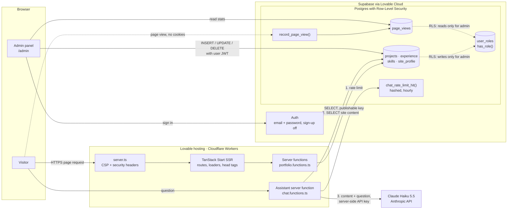
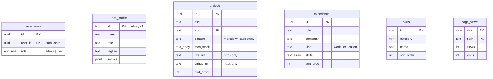

# Torsti Tapiola — Personal Website

Source code for my developer portfolio: a server-rendered React site where projects,
work experience, skills and profile details are stored in a Postgres database and
edited through a private admin panel, so updating the site never needs a code change.

**Live site: [torsti.dev](https://torsti.dev)**

## Features

- **Portfolio sections as separate routes:** home, experience, projects (with
  Markdown case studies), skills and contact, each with its own page title and
  meta tags for search engines and link previews.
- **Content from the database:** pages load their data on the server, so the
  first render already contains the content.
- **Admin panel at `/admin`:** create, edit, reorder and delete projects,
  experience entries, skills and profile information.
- **Database-enforced access control:** row-level security lets anyone read and
  only the admin role write. A UI check alone would not be enough, so the
  database enforces the rule.
- **AI assistant:** visitors can ask about experience, projects and skills in
  English or Finnish. The assistant answers only from the site's content and
  can point to the right page. Conversations are not stored.
- **Editorial, minimal design:** clean grid, monospace details, one accent
  colour, mobile-first layout.

## Tech stack

| Area | Tools |
| --- | --- |
| Framework | [TanStack Start](https://tanstack.com/start) (React 19, SSR, file-based routing, server functions) |
| Data fetching | TanStack Query (`queryOptions` + route loaders) |
| Database & auth | Supabase (Postgres, Row-Level Security, Auth) via Lovable Cloud |
| Migrations | Plain SQL files tracked with Drizzle Kit |
| UI | Tailwind CSS 4, shadcn/ui (Radix), Lucide icons, `react-markdown` |
| Tooling | Vite 8, TypeScript, ESLint, Prettier, Vitest, Bun |
| Hosting | Lovable (Cloudflare build target via Nitro) |

## Architecture





The content tables are independent: there are no foreign keys between them.
Access is controlled per table by RLS policies that call `has_role()`.

- **Reads** go through server functions in
  [`src/data/portfolio.functions.ts`](src/data/portfolio.functions.ts). Pages use
  them through `queryOptions` in [`src/data/index.ts`](src/data/index.ts), and
  each route's `loader` fills the cache before rendering.
- **Writes** go from the admin UI directly to Supabase. The database decides
  who may write: every table has a `"Admins manage"` policy that calls the
  `SECURITY DEFINER` function `has_role()`.
- **Security hardening** ([`0005_security_hardening.sql`](drizzle/migrations/0005_security_hardening.sql)):
  - No automatic admin grant on sign-up.
  - Anonymous users cannot call `has_role()`.
  - Project links must use `https://` (enforced with CHECK constraints).
  - Public sign-up is disabled in the auth settings.
- **Profile fallback:** [`src/data/profile.ts`](src/data/profile.ts) is used only
  if the `site_profile` row cannot be loaded.
- **Security headers:** [`src/lib/security-headers.ts`](src/lib/security-headers.ts)
  adds a Content-Security-Policy, frame protection and other headers to every
  server-rendered response.
- **Page view counter** ([`0006_page_views.sql`](drizzle/migrations/0006_page_views.sql)):
  stores only a count per page per day, with no cookies or personal data.
  Visitors can only call `record_page_view()`, and only the admin can read the
  stats at `/admin/stats`.
- **AI assistant** ([`src/lib/chat/`](src/lib/chat)):
  - **Request flow:** one request per question to Claude Haiku 5.5. The system
    prompt holds the public site content and is prompt-cached. A structured
    output (JSON schema) returns the answer and a suggested page from a fixed
    list, so the assistant cannot produce arbitrary links.
  - **Scope:** the prompt limits answers to the site's content and tells the
    model to decline everything else. [`scripts/eval-assistant.ts`](scripts/eval-assistant.ts)
    checks on-topic answers, off-topic questions and jailbreak attempts in
    English and Finnish.
  - **Abuse and cost:** questions and conversations have length limits. A
    database-backed rate limit allows 20 questions per hour per visitor and
    stores only an hourly HMAC of the IP address, deleted after two hours. The
    handler fails closed if the limit can't be checked.
  - **Privacy:** the conversation exists only in the browser tab. It is not
    stored or logged on the site, and the API key never leaves the server.

## Project structure

```
src/
  routes/            File-based routes (public pages + /admin)
  data/              Types, server functions and query options
  components/site/   Site header, footer and layout primitives
  components/admin/  Admin CRUD helpers
  components/ui/     shadcn/ui components (generated)
  integrations/      Supabase clients and generated DB types
drizzle/migrations/  SQL migrations (schema, RLS policies, seed data)
.agents/skills/      Task guides for AI coding agents (see below)
```

## Getting started

Requirements: [Bun](https://bun.sh) (or Node.js 22 + npm) and a Supabase project.

```sh
git clone https://github.com/tapiotorsti/torsti-tapiola-website.git
cd torsti-tapiola-website
bun install
cp .env.example .env   # fill in your Supabase URL, project id and publishable key
bun run dev
```

To create the database, run the SQL files in `drizzle/migrations/` in order
against your Supabase project, for example in the SQL editor. Migration `0000`
seeds sample content. To get admin access, sign up once through Supabase Auth
and add a row for your user to `public.user_roles` with the role `admin`.

| Command | What it does |
| --- | --- |
| `bun run dev` | Start the dev server |
| `bun run build` | Production build |
| `bun run lint` | ESLint |
| `bun run test` | Vitest test suite |
| `bun run format` | Prettier |

## How AI was used

AI tools wrote most of the code in this project. My goal was to use them to
move fast without giving up control over quality, security or
maintainability. I directed the work and made the decisions, and I am
responsible for the result, especially its security and architecture.

### At a glance

| Phase | Tool | Time | Result |
| --- | --- | --- | --- |
| Foundation | [Lovable](https://lovable.dev) | About 2 days (2–3 Nov 2026) | Working site: design, database, admin panel and hosting |
| Production-ready | [Claude Code](https://claude.com/claude-code) | 1 day (11 Nov 2026) | Security, dependency fixes, visitor stats, SEO, accessibility, documentation and open-source release |

What the production-ready day covered:
- 10 focused commits, about 1,900 changed lines in 46 files
- automated tests: 1 → 22
- known dependency vulnerabilities: 29 → 2 (both in dev-only tools)
- 0 accessibility violations in an axe-core scan (WCAG 2.2 AA)

The commit history shows the work step by step. In this phase, each commit
message explains what was changed and why.

### 1. The right tool for each phase

- **Lovable** for the foundation, where seeing the UI quickly matters most. I
  wrote the brief: an editorial, minimal look, the page sections, the stack,
  and a data layer that could later move to a database. Lovable generated the
  TanStack Start app, the design, the Supabase integration and the first admin
  panel, and it also hosts the site.
- **Claude Code** in the codebase for engineering work that needs tests,
  database migrations and careful review.

### 2. Decisions stay with a person

AI proposed; I decided.

**Architecture**
- Site content lives in the database, not in code, and is edited in the admin panel.
- Public pages read data through server functions.
- Every write goes straight to the database, and Row-Level Security is the
  only guard that counts. Checks in the UI are only for convenience.

**Security**
- I defined the hardening in
  [`0005_security_hardening.sql`](drizzle/migrations/0005_security_hardening.sql):
  - removed the trigger that made the first sign-up an admin
  - blocked anonymous calls to `has_role()`
  - allowed only `https://` links
- I closed public sign-up.
- I made or approved the other security choices:
  - the visitor counter collects no personal data
  - the Content-Security-Policy blocks external scripts without breaking the
    Lovable editor
  - the repository was checked for secrets before it went public

**Trade-offs**
- Rewriting the git history would have broken the sync with Lovable. Instead,
  I chose to publish a separate public copy whose commit metadata is cleaned
  by a repeatable script.

### 3. Verify, don't trust

In the Claude Code phase, every change had to pass the type check, the tests
and a production build. Beyond that:

- Database migrations were run in a local Postgres. Permissions were tested as
  an anonymous visitor, a normal user and the admin.
- The CSP was tested in a real browser against a production build: no blocked
  resources on any page.
- Accessibility was scanned with axe-core. Colour contrast was calculated from
  the theme tokens.
- Security settings were checked against the live site with read-only requests.

These checks caught AI mistakes before they shipped:
- The first project-card focus ring compiled to no CSS at all; checking the
  build output caught it.
- In the second attempt, the ring inherited `outline: none` and would have
  stayed invisible.
- A project note claimed that the first sign-up becomes admin, which had
  stopped being true. It was corrected before any agent could rely on it.

### 4. Build for the next change

- **The same rules for every future change.** The repository includes
  [instructions for AI agents](#instructions-for-ai-agents), so any agent that
  works on the code follows the same rules for security, accessibility, SEO and
  data access.
- **Tests guard the new logic,** so later changes can't silently break it.
- **Small, explained commits** keep every change easy to review and to revert.
- **Changes stay in scope.** Generated files were not edited by hand. The
  existing lint debt in generated code was documented instead of being
  reformatted as part of unrelated work.
- **Privacy and security by default.** The visitor counter stores no personal
  data, and dependencies are audited.

### Instructions for AI agents

The repository includes instructions for AI agents, so anyone who uses an
agent to work on the code gets the same project rules:

| File | Read by |
| --- | --- |
| [`AGENTS.md`](AGENTS.md) | Shared rules: OpenAI Codex, Cursor, GitHub Copilot, Gemini CLI, Jules, Zed, Aider and others that follow the AGENTS.md convention |
| [`CLAUDE.md`](CLAUDE.md) | Claude Code (imports `AGENTS.md`) |
| [`GEMINI.md`](GEMINI.md) | Gemini CLI (imports `AGENTS.md`) |
| [`.github/copilot-instructions.md`](.github/copilot-instructions.md) | GitHub Copilot |
| [`.agents/skills/`](.agents/skills) | Step-by-step task guides in the open Agent Skills format (`SKILL.md`) |
| [`.claude/skills/`](.claude/skills) | Pointers that let Claude Code discover the same skills |

## License

[MIT](LICENSE) © Torsti Tapiola
